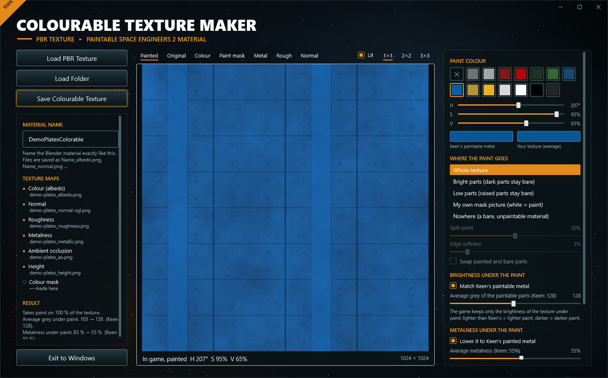
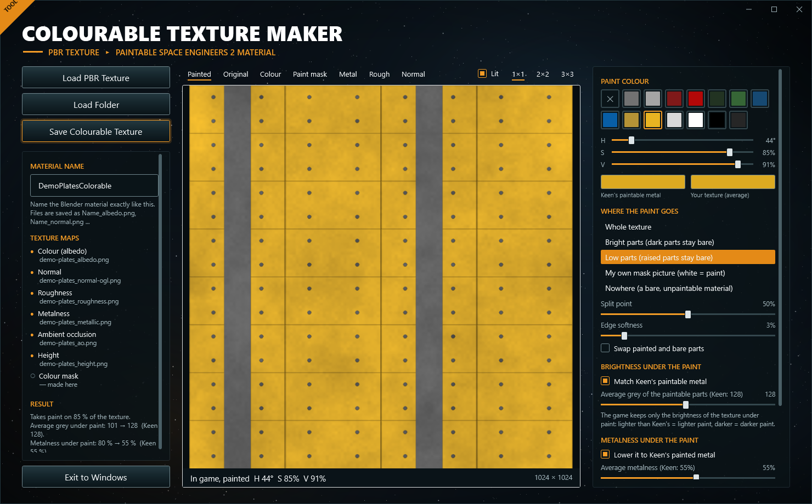

# SE2 Colourable Texture Maker

A small, portable Windows tool that turns any PBR texture set into a **colourable (paintable) material for
Space Engineers 2**. The result is ready to drop into the SE2 Mod SDK: blocks that use it take the player's paint
in game, just like Keen's own painted metal.

* One file, about 100 KB, **no install**.
* Live preview that paints the texture **the same way the game's shader does**, using SE2's own palette.
* Exports the PNG set the SDK expects: `_albedo`, `_metal`, `_roughness`, `_normal`, `_ao`, `_colormask`.



---

## Download

Get **`SE2 Colourable Texture Maker.exe`** from the [Releases](../../releases) page and run it. It works from any
folder (desktop, USB stick ...) on Windows 10 and 11, using the .NET Framework 4.8 that comes with Windows.

The exe is not code-signed. The first time you run it, Windows SmartScreen may say "Windows protected your PC".
Click **More info**, then **Run anyway**. Or build it yourself from the source (see below).

---

## How to use it

### 1. Load a PBR texture
Press **Load PBR Texture** and pick **any one** map of the set: the others in the same folder are found by their
file names. You can also press **Load Folder**, or drag the folder or the files onto the window.

| Map | Recognised names (any case, any separator) | If missing |
|---|---|---|
| Colour | `albedo`, `basecolor`, `diffuse`, `diff`, `color`, `col` | **needed** |
| Normal | `normal`, `nrm`, `nor` (+ `dx` / `directx` or `gl` / `ogl`) | flat |
| Roughness | `roughness`, `rough` (or `gloss`, `glossiness`, `smoothness`: turned round) | 50 % |
| Metalness | `metallic`, `metalness`, `metal` | not metal |
| Ambient occlusion | `ao`, `ambientocclusion`, `occlusion` | white |
| Height | `height`, `displacement`, `disp`, `bump` | only used by the "Low parts" mask |
| Colour mask | `colormask` | made by the tool |

PNG, JPG, BMP and TIF files are read. The colour map sets the size; other maps are resized to it.

### 2. Choose where the paint goes
Under **Where the paint goes**:

* **Whole texture**: everything takes paint (like Keen's `PaintedMetalColorable`).
* **Bright parts**: dark parts (grime, gaps) keep their own colour.
* **Low parts**: raised parts (rails, rivets, frames: from the height map) stay bare metal.
* **My own mask picture**: load a black-and-white picture, white = takes paint.
* **Nowhere**: a bare material that never takes paint (like Keen's `PaintedMetalDarker`).

**Split point** and **Edge softness** tune the bright / low split; **Swap** turns it round.



### 3. Check it with different colours
Click any of SE2's 14 starting paint colours, or set your own with the **H / S / V** sliders. The ✕ swatch shows
a block that was never painted. The view tabs show the painted result, the original, and every map that will be
saved (**Paint mask** shows exactly where paint will go). **Lit** adds a simple light so the relief shows;
**2×2 / 3×3** tile it to check seams.

The two swatches under the sliders compare **Keen's paintable metal** and **your texture's average** in the chosen
colour. If they match, your blocks will look as bright as Keen's next to them.

### 4. Brightness and metalness (on by default)
* **Match Keen's paintable metal**: under paint the game keeps only the *brightness* of your texture, so the
  paintable parts are turned greyscale and brought to an average grey of 128, as on Keen's own painted metal.
  A darker texture would give darker paint than the game's blocks, and a lighter one lighter paint. A curve is
  used, so nothing is clipped.
* **Lower it to Keen's painted metal**: many downloaded "metal" textures are 100 % metallic; Keen's painted metal
  is about 55 %. The metalness under paint is only ever lowered, never raised.

### 5. Save
Type the **material name** (letters, digits, `_`; it becomes the SDK material name), choose the size under
**Saved size**, press **Save Colourable Texture** and pick a folder. The tool makes a folder named after the
material with:

```
MyPlateColorable/
  MyPlateColorable_albedo.png
  MyPlateColorable_metal.png
  MyPlateColorable_roughness.png
  MyPlateColorable_normal.png       (OpenGL style, what SE2 uses; DirectX maps are flipped)
  MyPlateColorable_ao.png
  MyPlateColorable_colormask.png    (white = takes paint)
  How to use in the SE2 SDK.txt
```
All PNGs are 8-bit RGB without a colour profile (an embedded profile blocks publishing in the SDK).

### 6. Put it into your mod
1. In the **VRAGE editor**, make a folder in your mod, for example `Assets\BlockMaterials\MyPlateColorable`, and
   drag the PNG files into it.
2. Select them all, right-click > **Create Asset > Material > PBR Material**. The editor packs them and creates
   the material from the file name endings.
3. In **Blender**, give the faces a material named exactly `MyPlateColorable` (no `.001`). Map it like Keen's
   tiling materials: **0.4 UV per metre** (one 0-1 tile covers 2.5 m).
4. Export and import your model as usual: the SDK finds the material by its name. Build, and paint it in game.

---

## How SE2 paints a material (what the preview copies)

A colourable material is an ordinary SE2 PBR material whose packed `_add` texture holds a **colour mask** in its
blue channel. For every pixel, with mask `m` (0-1), the game's shader does:

```
grey  = max(R, G, B) of the colour texture       hue and saturation are dropped
out   = HSV(paint hue, paint saturation, clamp(grey + paint brightness - 0.55))
pixel = mix(texture, out, m)                      in linear light
```

So paintable parts should be **greyscale around mid-grey**, and the light and dark detail in them shows through any
paint colour. A material without a colour mask never takes paint. This was read from the shaders and data shipped
with the SE2 Mod SDK and checked in game: a block using a texture made this way was painted next to Keen's own
wall and matched it.

---

## Build it yourself

### What you need
* Windows 10 or 11.
* The **.NET SDK** 6 or newer ([download](https://dotnet.microsoft.com/download)), **or** Visual Studio 2022 with
  the ".NET desktop development" workload.
* Internet for the first build only: the .NET Framework 4.8 reference assemblies are restored from NuGet
  automatically.

### Steps
```
git clone https://github.com/CaptainChunck/SE2-Colourable-Texture-Maker.git
cd SE2-Colourable-Texture-Maker
dotnet build -c Release
```
The program is `bin\Release\net48\SE2 Colourable Texture Maker.exe`. That one file is all you need: copy it
wherever you like (the `.exe.config` beside it is optional).

In Visual Studio, open `SE2ColourableTextureMaker.csproj`, choose **Release** and **Build > Build Solution**.

### Project layout
| File | What it does |
|---|---|
| `Imaging.cs` | finds the maps by name, loads and resizes pictures, writes plain PNGs |
| `Converter.cs` | the conversion: colour mask, brightness curve, metalness, normal flip |
| `Renderer.cs` | the preview: SE2's paint formula plus a simple light |
| `MainWindow.xaml(.cs)` | the window and its controls |
| `App.xaml` | the look (styled on the SE2 main menu) |
| `FolderPicker.cs` | Windows' own folder picker |
| `tools/make_icon.ps1` | draws `app.ico` (`powershell -File tools\make_icon.ps1 app.ico`) |

A hidden check renders the window off-screen and saves a set without showing anything, handy for testing:
```
"SE2 Colourable Texture Maker.exe" --selftest <any map file> <output folder> Painted:8 mask=Low Painted:10 Mask
```
(`Painted:N` = palette colour N, `mask=` = Whole / Bright / Low / Custom / None, other words = a view tab.)

---

Fan-made tool, not affiliated with or endorsed by Keen Software House. Space Engineers is a trademark of Keen
Software House. The screenshots use a texture generated for this README.
